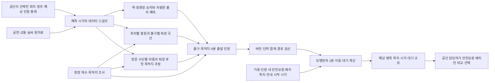

# OLPARK FLOW 공연 퇴장 수요 예측 연구·운영 설계

**2026년 11월 23일 작성 · 자료·원격 코드 확인 11월 22일 · 연구 대상 서울 올림픽공원 · 첫 현장 검증 대상 KSPO DOME**

**국민체육진흥공단 담당자가 내릴 결정은 이 공연의 퇴장 때 어느 통로가 언제 혼잡해질지, 가용한 안전요원을 어디에 언제 배치할지다.** 수요 모듈은 공연의 규모·장르·종료 시각과 관객의 차량·대중교통·도보 방문 특성을 이용해, 각 공연장 출구에서 5분마다 목적지별로 출발할 인원(명)을 추정한다. 보행망은 서로 다른 목적지로 가는 관객이 같은 통로에 모이는 흐름과 대기를 계산한다. 운영 담당자는 지도에서 예상 병목을 확인하고 같은 수요에서 안전요원 배치안을 비교한다.

2025년 자료로 방문·첫 귀가 수단 비중을 추정하고, 5분별 출발 인원을 보행 엔진에 넘기는 연구용 경로를 구현했다. 승하차·입출차는 교통 관측과 대조할 수 있다. 도보 비중·출구별 분포·병목 예측은 독립 현장 관측이 없어 정확도가 미확인이다. [구현과 사용법](../../../ml/olpark_demand/README.md) · [실측 검증](../../../ml/artifacts/egress-od/validation/README.md)

| 문서·부속물 | 쓰임 |
|---|---|
| 이 문서 | 연구 질문, 데이터 적합성, 의사결정, 인력·일정·인수 기준 |
| [모델·현장 연구 프로토콜](research-protocol.md) | 시간 기준, 수요모델, OD 추정식, 현장 표집, 실험 분할, 통계적 채택 기준 |
| [보행망 연동·운영 명세](integration-operations.md) | 병합된 PR의 코드, 입력 계약, 서비스·저장·재실행, 통합시험, 감시·복구 |
| [추정 결과 교환 형식 1.1](contract/demand-v1.1.schema.json) · [운영 가정 1.0](contract/demand-v1.schema.json) | 출구별 추정 결과와 가용 경로를 보행 엔진에 입력하고 인원·시간 경계를 검산 |
| [예비실험 재현 코드](evidence/reproduce_pilot.py) · [수치·입력 지문](evidence/pilot_2025.json) | 2025 분할, 자료 버전, 단위, 오차, 날짜 단위 불확실성 확인 |
| [주차 원자료 대조 코드](evidence/audit_remote_sources.py) · [전체 행 검산 결과](evidence/remote_sources_2025.json) | 누락 구간의 실제 기록 수, 차량·날씨 연계표와 차량 원장의 수치 관계 확인 |

## 1. 운영자가 받는 제품

| 결정 시점 | 그 시점에 확보할 입력 | 결과와 쓰임 |
|---|---|---|
| 공연 선택·주간 계획 | 공단 대관 일정 또는 공식 공연 목록, 공연장·회차·장르·예상 퇴장 인원 범위·예정 종료, 사용 가능한 출구·목적지·안전요원 수 | 예상 병목과 사전 배치를 검토할 구간을 지도에서 확인한다. 유사 공연, 보행망 적용 범위·미배정 인원, 장기 날씨 시나리오를 근거로 함께 본다. |
| 전날 17시 KST | 이때까지 도착한 일정 수정·예매/예상 인원·기상예보·공식 통제 공지 | 출구·목적지별 5분 출발 인원을 보행망에 넣고, 같은 수요에서 안전요원의 배치 위치·안내 시작 시각에 따라 어느 구간의 대기가 얼마나 달라지는지 비교한다. |
| 종료 예정 60분·15분 전과 실제 종료 통보 때 | 확인된 입장 합계·문 개폐·담당자 수정·최신 예보, 계측이 연결된 곳의 현장 관측 | 이미 퇴장한 사람과 장내 잔류 인원을 반영해 병목 예상 시각과 위치를 갱신한다. 담당자는 변경 이유와 남은 시간을 보고 배치 조정을 결정한다. |
| 공연 종료 뒤 | 확정 입장·퇴장, 독립 계수·설문, 운영 조치 로그, 뒤늦게 공개된 교통 통계 | 모델 예측, 조건 변경, 현장 결과를 동일 시간축에서 대조하고 다음 평가에 사용할 정답을 동결한다. |

등록 범위는 기존 서비스가 정의한 KSPO DOME·티켓링크 라이브 아레나·올림픽홀·우리금융아트홀이다. 그래프에 출구와 목적 경로가 연결된 장소부터 공간 결과를 제공한다. 동일 시각 다른 공연은 교통수요에 함께 포함하고, 그래프 미등록 공연의 인원은 별도 집계한다. 우천·동시 종료·연말·매우 큰 공연은 별도 성능표를 가진다. 각 조건의 검증 상태는 운영 화면에 따라간다. [기존 공연장 타입][types]

## 2. 무엇을 측정하고 무엇을 연구할 것인가

| 대상 | 단위·공간 | 근거 | 운영 승인에 필요한 확인 |
|---|---|---|---|
| 지하철·버스 총승차 | 명 / 역·호선 또는 정류장·방향 / 원 시간구간 | 교통기관 승차 집계, 일반 이용객 포함 | 동일 시점 기준선과 미래 행사에서 비교. 행사 종료 구간의 피크 과소예측과 구간 폭 확인 |
| 차량 총출차 | 대 / **차량 출구 문** / 관측 시간구간 | 출차 시각과 차로를 문에 연결 | 입차 자료 누락이 출차에 미친 영향, 자료원·문별 대상 범위 검증 |
| 공연 관련 증가분 | 명 또는 대 / 지점·관측 구간 | 총수요와 비교일의 배경수요 차이 | 비교일 선정·동시 행사 민감도, 음수 차이와 구간 함께 제공 |
| 퇴장 인원과 출발 곡선 | 명 / 공연 회차·실제 운영 출구 / 5분 | 예상·입장 합계, 출구 방향별 계수, 실제 종료 시각 | 독립 계수에 대한 인원 오차와 중앙·90% 퇴장 시각 오차 |
| 출발지–목적지 수요(OD) | 명 / 회차·출구·첫 귀가 목적지 / 5분 | 표본조사·현장 계수·보존 제약·명시한 가정 | 보유한 관측으로 구별 가능한 수준, 오차 범위, 미배정·미연결 인원 |
| 경로 대기와 운영안 차이 | 명·분 또는 대·분 / 보행 링크·차량 출구 | 위 시나리오와 네트워크 엔진 | 독립 링크 관측, 쌍을 이룬 시나리오 비교, 현장 운영자의 판단 한계 확인 |

올 때 이용한 수단은 퇴장 동선을 추정하는 입력이다. 귀가 때 차량을 이용하는 사람은 주차장이나 승하차 지점까지, 대중교통 이용자는 역 출입구나 버스 정류장까지, 걸어서 귀가하는 사람은 공원 경계의 보행 출입구까지 보행망에 포함한다. 버스에서 지하철로 환승하면 첫 목적지는 버스 정류장이다. 수단·목적지가 미정인 사람도 총원에 남긴다. 출구별 관객과 역 개표 인원은 명, 차량문 통과량은 대로 집계한다. 예상 퇴장 인원은 주최사 자료를 바탕으로 잡고 실입장·재입장·조기퇴장·잔류와 대조한다.

| 연구 질문 | 반증 가능한 가설 | 판정 자료 |
|---|---|---|
| R1. 공연 특성이 교통수요 피크 예측을 개선하는가? | 일정·규모·예보의 기여를 평가하고, 이 조건이 같을 때 트로트·아이돌 등 세부 장르가 추가로 출차·승차 예측 오차를 줄이는지 시험한다. | 같은 미래 공연에서 장르 미사용·공식 대분류·세부 장르의 시간대별 오차와 피크 과소예측을 수단별로 비교 |
| R2. 5분 출발 분포를 현장에서 보정할 수 있는가? | 출구 계수로 보정한 곡선이 기존 감마 곡선보다 독립 공연의 출구별 누적 곡선과 실제 피크에 가깝다. | 실제 종료, 전 출구 계수, 검측 조사원의 독립 표본 |
| R3. 목적지와 수단의 세분화에 증거가 충분한가? | 확률표본과 시차 보정으로 식별 가능한 항목에서 운영자 기본 비중보다 목적지별 오차가 작다. | 미사용 행사·출구·설문, 표본오차, 서로 다른 가능 OD와 운영안 순위 |
| R4. 배포 시각에 쓸 수 있는 이력에서 복잡한 모델이 도움이 되는가? | 과거값의 제공 지연을 재현해도 기초 시계열 모델 또는 결합모델이 단순 후보의 오차와 의사결정 손실을 개선한다. | 입력 가용 조건을 고정한 후보 간 시험, 지연·비용까지 함께 기록 |
| R5. 수요 모델을 연결하면 공단이 실제 병목을 찾고 배치안을 고르는 데 도움이 되는가? | 같은 망·운영안에서 고정 수단 비중을 쓴 경우보다 실제 병목 누락과 발생 시각 오차가 줄어든다. 같은 수요·인력 조건에서 배치안별 대기 변화를 비교할 수 있다. | 공연 전 기록한 구간별 예측, 독립 현장 관찰과 대기 계수, 배치 위치·시각·안내 이력 |

## 3. 사용할 수 있는 자료와 빈 구간

아래 숫자의 기준은 로컬 준비 자료와 2026-11-22 원격 `main`의 커밋 `48e50c3614e2b8786062278ede9c2b822ea6f4b7`이다. 로컬에서 정제한 자료와 PR에 포함된 자료는 각각 원본 지문과 수집 경로를 유지한다. [로컬 데이터 목록](../../../ml/data/README.md) · [파일별 수집 명세](../../../ml/data/manifest.json) · [원격 차량 자료][vehicles] · [원격 기준 커밋][main]

| 출처 | 확인한 범위 | 설계에 미치는 영향 |
|---|---|---|
| 공식 공연 일정·KOPIS | 공식 125개 행사 중 113개에서 예정 회차 521개를 구성했다. 12개는 시간 해석 보류. KOPIS 127개 중 대중음악 114개, 출연진 기재 88개 | 장소와 회차를 먼저 연결하고 정정·취소와 등록 시점을 보관한다. 같은 투어·장기 공연이 만든 여러 회차에는 군집 가중치를 적용한다. |
| 전날 이용 가능한 일정 | 전날 17시까지 등록된 표가 500회차·112행사·190일. 그중 단일 런타임으로 예정 종료를 계산할 수 있는 회차 414개. 서로 다른 행사 두 개 이상인 날 103일 | 등록 시각은 최종 수정 전 내용을 보증하지 않아 500회차는 가용 상한이다. 전향 연구는 예측 당시의 페이지·입력 스냅샷을 저장한다. |
| 철도 | 올림픽공원 5·9호선, 몽촌토성 8호선, 한성백제 9호선의 365일·32,120개 원 구간. 1~8호선 자료에 ‘06시 이전’, ‘24시 이후’ 합산 구간 존재 | 호선·역번호·수송일자·구간을 보존한다. 5·9호선의 동일 역사와 지상 3번 출구 사이에는 관측되지 않은 배분이 있다. 자료의 2026년 공개일을 기록한다. |
| 버스 | T-DATA 11/22~12/31에 40일, 페이지 완결 38일. 완결 944,256개 노선·정류장·순번·시간행 중 승차 기재 402,797개. STCIS는 1/1~2/11의 14곳, 13곳 42일·1곳 28일 | 두 시간대 자료의 겹치는 날짜가 없다. 365일 일합계와 월별 시간대 합계는 주변합 검산에 쓴다. 시간대 정답을 평가할 수 있는 정류장과 기간을 따로 표시한다. |
| 주차 월별 CSV | 2025 입차 3,091,265건, 1~11월 중 332개 입차일. 7/31·8/2 입차 누락. 12월 표제 파일에는 2025년 6월·2024년 8월 입차가 들어 있다 | 출차 예측 정답은 실제 출차 시각으로 집계한다. 누락일·인접일·장기주차 꼬리의 선택 영향을 기록한다. |
| 주차 문화광장 API | 로컬은 일부 페이지, 원격 PR #7에는 2,411,225행. 7/31 입차 0행·출차 264행, 8/2 입차 2,073행. 12월 마지막 입차는 12/7 16:08:25. 그 시각 이후 연말까지 출차 3,555행은 남아 있다. | 남은 출차는 먼저 들어온 차량의 일부다. 이 구간의 전체 수요를 알 수 없다. 월별 CSV와 API 간 같은 시각·출입문 일치율은 2월 이후 낮아 출처별 결과를 따로 낸다. 역전 6,288행의 포함/제외 효과도 점검한다. [전체 검산](evidence/remote_sources_2025.json) · [시각 역전 감사][audit] |
| 2025 차량·날씨 연계 자료 | PR #8의 7,803시간은 차량 원장에 입차나 출차 기록이 있는 시간과 정확히 일치한다. 7,803행 모두 주차대수는 0에서 시작한 시간별 누적 입차−출차와 일치했다. ‘방문객’은 그 값의 3배(5,224행) 또는 5배(주말·제공처 휴일 표기, 2,579행)였다. | 관찰된 수치 관계로는 실제 초기 점유나 실제 관객 수를 확인할 수 없다. 연간 957개 공백의 독립 보완, 관객 수 정답, 별도 성능 검증에 사용할 수 없다. [원본 지문과 검산](evidence/remote_sources_2025.json) |
| 기상·달력 | 서울 ASOS 8,760시간. 주변 두 격자의 지점 예보 2,505,360행, 선행 6~103시간. 별도 17시 발표→20시 예보 4,380행. 달력 365일 | 예측 기준 전에 공개된 발표분에서 대상 시각이 맞는 값을 사용한다. 기상 관측·향후 실제 강수는 사후 분석용. 임시공휴일은 공표 시점 이후 적용한다. |
| 보행·운영 | 로컬 송파·강동 보행망은 2026년판. 원격은 DOME의 20개 노드·20개 간선, A/B/C 경로, 6개 주차장과 3개 차량 출구 | 역사 검증에는 당시 개방·폭·공사 상태가 필요하다. 경로·교통수단별 통제 가능 범위를 시설 운영자와 확인한다. [네트워크 구성과 근거][network] |

원격 팀의 DOME 공연표에는 2023~2025년 132개 기간 중 숫자가 적힌 101개, 사용 표시가 있는 98개가 있다. 2025년은 48개 기간 중 40개에 숫자가 있다. 규모 확인을 위한 단서로 사용하고 출처·합산 기간·회차 귀속·입장 정의가 입증된 값만 회차 정답으로 승격한다. 원격의 여러 해에 걸친 일 단위 역 자료는 연간·계절 변화 검산에 사용할 수 있지만 한 해뿐인 시간별 시험의 외부 검증을 대신할 수 없다. [기존 공연 기간표][periods] · [기존 자료·방법][network]

문화광장 차량 원본의 입차가 남은 날짜는 308일이다. 8·9·11·12월은 각각 65,534행으로 끊겨 있다. 주차 예비실험에는 월별 CSV에서 만든 문별 정제 파일을 사용했다. 7월 31일과 12월 7일 이후의 입차 원본 추가 확보는 연말 검증 범위를 늘린다. 그 두 구간을 복구해도 5분 퇴장·목적지 연구에는 현장 관측이 필요하다. [자료원별 검산](evidence/remote_sources_2025.json) · [예비실험 입력 지문](evidence/pilot_2025.json)

## 4. 이미 확인한 예측 성능

시각·요일·지점별 중앙값과 CatBoost를 동일한 목표에 맞춰 다시 비교했다. 2025년 1~8월 학습, 9~10월 조정, 철도는 11~12월·주차는 11월 평가다. 수치는 **실제 지점·1시간당 평균절대오차(MAE)**다. 종료창은 런타임으로 얻은 예정 종료 시각이 속한 시간과 이후 두 시간이다. 모델은 달력과 회차 정보를 사용했고 날씨·실관객 수는 이 비교의 입력에서 제외했다. [재현 결과](evidence/pilot_2025.json)

| 평가 대상 | 시험 행과 날짜 | 중앙값 | 달력 CatBoost | 달력·공연 CatBoost |
|---|---:|---:|---:|---:|
| 철도 4개 역·호선, 06~23시 | 4,392행 · 61일 | 78.75명 | 83.64명 | 86.09명 |
| 철도, 예정 종료창 | 968행 · 39일 | 206.82명 | 210.20명 | 215.54명 |
| 주차 3개 문, 관측된 시간 | 1,551행 · 30일 | 30.42대 | 31.62대 | 29.88대 |
| 주차, 예정 종료창 | 180행 · 16일 | 108.06대 | 107.24대 | 94.84대 |

종료창의 같은 시험 날짜를 묶어 10,000번 재표집했다. 공연 CatBoost의 MAE에서 중앙값 모델의 MAE를 뺀 차이는 철도 **+8.71명**(95% 구간 −14.65~+28.53), 주차 **−13.22대**(−25.77~−3.32)였다. 전자는 어느 모델의 우위인지 정하기 어렵고, 후자는 이 16일 표본에서 개선됐다. 철도는 중앙값을 비교 기준으로 유지하고 주차 공연모델은 후속 시험 후보로 둔다. 같은 투어·연속 행사일을 묶을 때의 불확실성은 별도 검증이 필요하다. [날짜별 짝지은 재표집 결과](evidence/pilot_2025.json)

주차 시험은 3개 문 **모두 출차행이 있는 시각**만 포함했고 12월은 제외했다. 낮은 수요·영업 종료·수집 중단이 섞이므로 이 수치를 연말이나 24시간 서비스 오차로 쓸 수 없다. 예비실험은 회차 시작일 자정 전에 최초 등록된 일정을 사용했고, 휴일 인접일 특성의 일부는 최종 달력을 썼다. 향후 전날 17시 상품은 당시 일정 수정판·공표된 달력·자료 수신 시각까지 재현해야 한다. 날씨·새로운 투어·실시간 피드는 각각 새 실험에서 검정한다. **이미 결과를 본 2025년 11~12월은 앞으로 독립 최종 시험으로 쓸 수 없다.**

## 5. 채택할 설계

1. **교통 측정 지점별 확률 예측.** 철도·정류장·차량 게이트별 고유 단위로 중앙값, 부분풀링 음이항 회귀, CatBoost를 비교한다. 배경 패턴에 공연 시작·종료·규모별 반응을 더하는 모델을 주요 연구 후보로 둔다. 최신 시계열 기반 모델은 입력 이력이 배포 시점과 일치하는 별도 조건에서만 비교한다.
2. **시간대별 관객 배분.** 운영자 예상 총원과 현장 계수로 출구별 출발 곡선을 정하고, 표본조사와 교통 관측의 지연을 이용해 가능한 목적지 배분과 범위를 구한다. 알려진 정보로 구별할 수 없는 두 배분이 현장 결정을 바꾸면 두 경우를 모두 보여준다.
3. **같은 수요에서 운영안 비교.** 하나의 시나리오 안에서 모든 행사·목적지의 인원을 보존한다. 기존안과 변경안에 똑같은 수요와 난수 표본을 넣는다. 방향 전환·순응도·통제 적용은 엔진의 운영안 조건으로 기록한다.
4. **경로별 근거와 미배정 인원.** 현재 등록부에는 KSPO DOME의 출구 3개에서 철도 방면 3곳, 버스 정류장 7곳, 주차장 접근점 1곳, 도보 출입구 방면 1곳을 향하는 36개 경로가 있다. 철도 외 연결은 공간자료로 재구성했다. 개별 주차장 보행 입구, 픽업과 미연결 정류장, 다른 공연장의 출구에 미배정된 관객도 목적지 정보 및 사유와 함께 보존한다. [현재 접근 등록부](../../../src/data/egress-access.json) · [엔진 연동 명세](integration-operations.md)
5. **배포 단위는 모델 × 관측지점 × 예측 시점 × 용도.** 지하철 승차 예측이 승인돼도 5분 출구 배분과 운영 경보는 독립된 근거가 필요하다. 운영 중 승인 범위를 벗어나면 마지막 유효 예측 시각과 운영자 시나리오를 표시한다.

공단이 사용할 수 있는 대관 자료에서 해당 회차의 장르를 먼저 가져온다. 세부 장르가 비면 공식 공연 소개와 출연진 자료에서 보완한다. 과거와 신규 공연에 같은 분류 기준을 적용하고, 장르가 불명확한 회차도 예측에 포함한다. CatBoost와 Chronos-2 미세조정은 수단별 시험으로 채택 여부를 정한다. 차량의 관측 정답은 기록이 남는 차량문 단위로 정의하고 주차구역 귀속에는 별도 매핑과 검측을 요구한다. 공연장 출구·첫 목적지·시간을 함께 확인하는 전향 조사를 연구 일정과 현장 사용 승인에 포함한다. [원격 수요팀 개발 범위][team-a]



## 6. 개발 및 현장 인수 계획

기간은 **설계 추정치**다. 주최사 협력, 장비 설치·검측 가능일, 필요한 독립 공연 수가 일정을 결정한다. 다음 단계로 넘어가는 기준은 산출물과 검측 결과다.

| 단계·예상 소요 | 주 담당 / 협업 | 작업과 인수 증거 |
|---|---|---|
| 1. 운영 결정·사전등록, 1~2주 | 연구 책임자 / 시설 운영자·보행망 | 의사결정 시각과 리드타임, 기준선, 지점 목록, 오차 비용·허용 범위, 통제 권한, 독립 시험 모집단을 서면 확정. 사전등록본 해시와 변경 이력 보관 |
| 2. 과거 재현·계약 동결, 2~3주 | 데이터·ML / 엔진 통합 | 자료원별 입력 지문·시간 유효성, 수요 집계의 분모와 결측 지도, 기준 모델 재현, 계약 양·음성 시험, 실제 엔진과 합계 대조 |
| 3. 현장 조사 예행과 모델 비교, 3~5주 병행 | 현장 조사 책임자 / 연구·시설 | 계수기 교정, 조사 동선·표집 간격·동의 절차, 지연·승차인원 표본, 투어별 분할 실험, 필드별 근거 표시와 보류 동작 |
| 4. 미래 공연 그림자 운영, 표본 충족까지 | ML 운영 / 현장·교통기관 | 의사결정 전에 예측 봉인, 원 운영 절차로 행사 진행, 별도 검측 인력의 관찰, 오경보·누락·도달시간·지연 회고. 개발에 사용한 행사를 확증 표본에서 제거 |
| 5. 제한 장소의 의사결정 보조 | 현장 책임자 / 데이터·엔진 | 검증을 통과한 장소·시점에만 사용. 담당자가 대안·불확실성·미배정 규모를 확인하고 조치한다. 입력 단절·통제·복구 훈련과 이전 버전 복귀를 검수 |
| 6. 확대·재검증 | 운영 책임자 / 신규 장소·교통기관 | 공연장마다 출구·목적지·경로와 수송 통계를 새로 매핑. 새 계절·연말·대규모·동시 행사별 성능과 사용자 판단시간 재검증 후 범위 갱신 |

| 담당 | 책임과 인계 |
|---|---|
| 수요 연구(A) | 학습용 관측·특성, 교통 예측, 공연 추출·유사 공연, 인원 보존 OD, 시나리오 ID, 데이터·모델 카드와 오차 단위 |
| 보행망(B) | 버전이 고정된 노드·경로·주차구역 접근점, 유효기간·폐쇄·접근성, 이동·대기·차량 지연, 처리량과 현장 검측 근거 |
| 엔진·화면 통합 | 현 계약·신규 계약 어댑터, 검증 상태와 입력 공백 표시, 동일 수요 비교, 실제 계산 시간·복구·권한 감사 |
| 주최사·시설·교통 운영자 | 예정/실제 종료, 현장 개폐·입장·퇴장 집계의 정의, 결정 마감·조치 비용, 조사 승인과 현장 최종 판단 |
| 독립 검증 담당 | 봉인한 예측·정답 버전 관리, 보정과 분리된 평가, 결측·제외 사례 포함 보고, 승격·복귀 조건 확인 |

**연구 완료를 판정할 자료**는 재생 가능한 데이터·환경 지문, 비교군과 불확실성이 포함된 결과표, 독립 현장 검측표, 보행망 인수시험 결과, 담당 운영자의 사용 범위 승인, 장애복구 훈련 기록이다. 이 설계에는 교환 사양·가상 예제·검사기, 과거 자료 예비실험과 주차 원본 대조 결과를 동봉했다. 현장 검측, 운영 연결, 전향 성능, 의사결정 효과는 후속 연구의 결과물이다.

### 부속물 재현

저장소 루트에서 Python 3.12.13을 사용했다. 첫 명령은 합성 패킷을 확인하고, 두 번째는 로컬 `ml/data/prepared`의 정제 파일 네 개에서 12개 MAE와 종료창 재표집 결과를 다시 계산한다. 세 번째는 같은 커밋의 원격 저장소에 있는 두 압축 파일의 실제 경로를 인자로 받는다. 표준출력으로 결과를 내므로 저장된 결과와 직접 비교할 수 있다. 예비실험 패키지 버전과 네 파일의 SHA-256은 결과에 있고, 예제 검사는 `jsonschema==4.26.0`, 원본 대조는 Python 표준 라이브러리를 사용한다. [실험 환경과 해시](evidence/pilot_2025.json) · [압축 파일 원본과 해시](evidence/remote_sources_2025.json)

```sh
python docs/design/egress-demand/contract/validate_example.py --self-test
python docs/design/egress-demand/evidence/reproduce_pilot.py --data-dir ml/data/prepared
python docs/design/egress-demand/evidence/audit_remote_sources.py /path/to/olympicpark_inout_2025_full.csv.gz /path/to/olympicpark_linked_2025.csv.gz
```

[main]: https://github.com/jungwuk-ryu/olpark-flow/tree/48e50c3614e2b8786062278ede9c2b822ea6f4b7
[team-a]: https://github.com/jungwuk-ryu/olpark-flow/blob/48e50c3614e2b8786062278ede9c2b822ea6f4b7/docs/tasks/team-a.md
[types]: https://github.com/jungwuk-ryu/olpark-flow/blob/48e50c3614e2b8786062278ede9c2b822ea6f4b7/src/data/contract.ts#L7-L19
[vehicles]: https://github.com/jungwuk-ryu/olpark-flow/blob/48e50c3614e2b8786062278ede9c2b822ea6f4b7/geo/data/README.md
[audit]: https://github.com/jungwuk-ryu/olpark-flow/blob/48e50c3614e2b8786062278ede9c2b822ea6f4b7/docs/methods/vehicle-time-audit.md
[periods]: https://github.com/jungwuk-ryu/olpark-flow/blob/48e50c3614e2b8786062278ede9c2b822ea6f4b7/geo/validate/kspo-dome-events.csv
[network]: https://github.com/jungwuk-ryu/olpark-flow/blob/48e50c3614e2b8786062278ede9c2b822ea6f4b7/docs/methods/network.md
[routes]: https://github.com/jungwuk-ryu/olpark-flow/blob/48e50c3614e2b8786062278ede9c2b822ea6f4b7/src/data/routes.json
