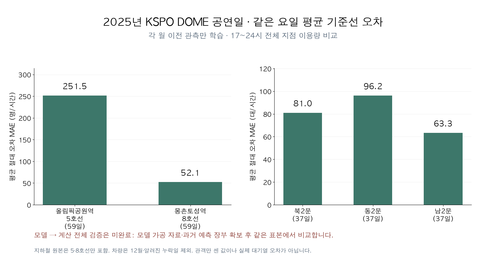

# 2025년 KSPO DOME 공연일 실용성 검증

**진행 상태: 실측 원자료의 시간순 기준선 채점은 완료, 팀원 A 예측 → 보행·차량 계산의 전체 채점은 미완료다.** 현재 체크아웃에 모델 실행·재학습용 비공개 가공 자료가 없다. 아래 수치는 모델 성능이나 개선율이 아니다.

## 평가 방법

- 확인한 main: `eb2db24` (PR #16~#18 반영). 배포 모델 `rail-2026-11-v3`는 2026년 11월까지 학습했다. 이를 2025년에 그대로 적용하면 미래 자료가 섞이므로 채점하지 않았다.
- 공연일은 `geo/validate/kspo-dome-events.csv`의 `use=yes` 날짜 범위를 일자로 펼쳤다. 2025년 전체 105일이다. 여러 날의 합계로 적힌 관객 수를 일별 실제 관객 수로 나누지 않았다.
- 학습 시작은 2025-01-01, 평가 대상은 2025-07-01~12-31 공연일이다. 매월 1일을 원점으로 그 월 이전 관측만 학습한다. 같은 지점·실제 요일(월~일 7종)·시간의 평균을 기준선으로 하고, 같은 요일 표본이 없을 때만 같은 지점·시간 평균으로 대체한다. 이전 공연일도 포함하는 단순 예측 기준선이다.
- 실제 종료시각을 모르므로 17~24시의 7개 정시 구간을 사전에 고정했다. 이 범위는 공연 직후 3시간이나 관객 퇴장 시간의 실측이 아니다. 모델 시간대 검증 때도 같은 시간 범위와 같은 원자료 행을 사용해야 한다.
- 사용 원본: `공공데이터 활용 공모전/data/raw/seoulmetro_station_hourly_2025.csv.gz`, `geo/data/olympicpark_inout_2025_full.csv.gz`. 원문 파일 SHA256·집계 범위는 `geo/validate/practical/result.json`에 기록했다. 공연명·출연자명은 결과에 넣지 않았다.
- 차량은 입차보다 출차가 빠른 **6,288건**을 제외했다. 세 문 모두 같은 날짜의 입차·출차 기록이 있는 날만 0을 구성한다. 기록 없는 날짜는 0대로 채우지 않는다. 입차 월 원장 범위 밖의 12월, 알려진 누락일 7/31·8/2 및 이튿날도 제외했다. 필터 후 비교 후보는 298일(1/1~11/7)이므로 11월 말까지의 완전한 원장이라고 해석하지 않는다. 날짜 포함 조건이 시간별 수집 완전성을 보증하지는 않는다.

## 같은 요일 평균 기준선 결과

| 지점 | 평가 공연일 | 시간별 표본 | MAE | RMSE | WAPE | 저녁 합계 MAE |
|---|---:|---:|---:|---:|---:|---:|
| 올림픽공원역 5호선 | 59일 | 413 | 251.5명/시간 | 441.5명/시간 | 55.1% | 611.9명 |
| 몽촌토성역 8호선 | 59일 | 413 | 52.1명/시간 | 93.9명/시간 | 16.1% | 308.2명 |
| 북2문 | 37일 | 259 | 81.0대/시간 | 106.7대/시간 | 63.5% | 471.5대 |
| 동2문 | 37일 | 259 | 96.2대/시간 | 119.0대/시간 | 65.6% | 558.8대 |
| 남2문 | 37일 | 259 | 63.3대/시간 | 82.2대/시간 | 84.1% | 341.8대 |

MAE는 각 시간 오차 절대값의 평균, RMSE는 제곱 오차 평균의 제곱근, WAPE는 절대 오차 합을 실측 합으로 나눈 값이다. 저녁 합계 MAE는 지점별 17~24시 합계의 날짜별 절대 오차 평균이다. 명과 대를 한 점수로 합치지 않는다.



## 요청한 예측 항목별 확인 상태

| 항목 | 현재 확인 가능한 정답 | 모델 → 계산 결과 | 기준선 대비 개선 |
|---|---|---|---|
| 퇴장 인원 | 회차별 스캔 인원 없음. 역 승차는 일반 방문객·동시 공연 포함 | 미산출 | 판단 불가 |
| 시간대별 역 수요 | 올림픽공원역 5호선·몽촌토성역 8호선만 시간별 승차 확보 | 재학습 자료 미확보로 미산출 | 판단 불가 |
| A/B/C 방면 비중 | 9호선 원본 부재로 A의 9호선·B 전체가 빠짐 | 2개 노선 비중을 전체 방면 비중으로 사용하지 않음 | 판단 불가 |
| 시간대별 차량 | 세 문 전체 이용객 출차 대수. 동승 인원·공연 참석 여부 없음 | 운영 모델 실행 자료 미확보로 미산출 | 판단 불가 |
| 보행 대기·밀도·요원 효과 | 현장 링크별 대기·통과 인원 정답 없음 | 계산 실행 검사는 가능하나 현실 오차 측정은 별도 | 판단 불가 |

**현재 모델이 단순 기준선보다 낫거나 못하다는 결론을 새로 내릴 수 없다.** 기존 모델 카드의 점수는 다른 표본·기준선(요일 중앙값 포함)·모델 판본을 쓰므로 이 평균 기준선 표 옆에 옮겨 개선율을 만들지 않는다. [기존 2025 검증](../../ml/artifacts/egress-demand/2025-d1/MODEL_CARD.md)과 [기존 모델 전체 연결 검증](../../ml/artifacts/egress-response/rail-2026-11-v3/MODEL_CARD.md)은 별도 근거로 유지한다.

## 전체 검증을 마치는 데 필요한 자료와 절차

1. `ml/data/README.md`의 [모델 실행 자료](../../ml/data/README.md#예측-서버-실행-자료)를 팀원 A의 로컬 경로에서 읽는다. 특히 `ml/data/prepared/response/sessions.parquet`, `rail_hourly.parquet`, `calendar.csv`가 필요하다. 현재 저장소와 사용자 Desktop·tmp에서 해당 파일을 찾지 못했다. 서버 실행에는 나머지 수단·목적지 가공 자료도 필요하다.
2. 2025년 7~12월 각 원점마다 팀원 A의 현재 규칙(V3 전날 사양)을 **그 원점 이전 자료로 다시 학습**한다. 관객 이력·출연자 이력·수단·목적지 분담·당일 보정도 같은 시점 이전으로 제한한다. 2026년 번들·보정식·5분 곡선을 그대로 재사용하지 않는다. 운영자의 실제 종료시각·실관객 수를 주는 실험은 전날 예측과 별도 표시한다.
3. 당시 전날 17시까지 공지된 회차만 입력한다. 과거 공지의 수정 이력이 없고 원본 보관본도 2026년에 확보했다면, 관측 날짜를 제한한 후향 재분석이라는 한계를 적는다. 시간순 분리만으로 실제 2025년 당시의 정보 가용성이나 이미 본 자료에 대한 모델 선택 편향이 해소되지는 않는다.
4. 각 예측을 화면의 `defaultParams → buildInput → simulate`와 같은 경로로 실행한다. 90분 화면 범위에 남은 인원과 추가 꼬리 계산을 구분하고, 역 입구 도착을 개찰구 승차와 같은 관측으로 간주하지 않는다. 관객 예측만 나오는 경우 과거 자료로 만든 비관객 배경을 더한 전체 수요와, 대조일 증가분을 쓰는 관객 대리 지표를 별도로 비교한다.
5. 실측과 동일한 지점·단위·정시 구간으로 집계해 예측 전/계산 후를 각각 채점한다. 자동차는 사람 수가 아닌 대수로 비교하고 동승 인원 2.4명 가정을 명시한다. A/B/C는 9호선 원본을 확보한 뒤 같은 세 역을 정규화한다. 실제 대기 관측이 없으면 대기열 오차를 주장하지 않는다.

이미 시간순 재학습·계산을 거친 장부가 있으면 아래 채점기를 사용할 수 있다. CSV 열은 `date,site,hour,train_end,phase,prediction`이다. `phase`는 `model` 또는 `engine`, `site`는 결과 JSON의 ID를 사용한다. `prediction`은 정답과 같은 전체 이용량·단위여야 한다. 같은 표본의 기준선과만 비교하며 대상 월 이후 학습·중복·음수·무한대 값은 거부한다. 이 검사는 장부가 주장하는 학습 시점을 확인할 뿐, 실제 모델 학습과 특성 정보 유출 감사를 대신하지 않는다.

```sh
python3 geo/validate/practical_validation.py
python3 geo/validate/practical_validation.py --model-predictions /안전한/작업경로/예측장부.csv
MPLCONFIGDIR=/tmp/olpark-mpl python3 geo/validate/make_practical_figure.py
PYTHONDONTWRITEBYTECODE=1 python3 -m unittest discover -s geo/validate -p test_practical_validation.py
```

분석은 Python 표준 라이브러리로 실행한다. 그림에는 matplotlib와 한글 폰트가 필요하다. `geo/validate/practical/baseline-hours.csv`는 날짜·지점·시각별 원자료 집계와 과거 기준선이며 출차 원본의 차량 ID·출연자명·키를 포함하지 않는다.
