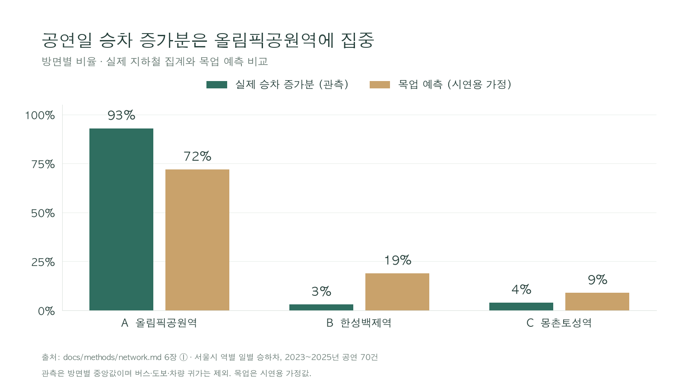
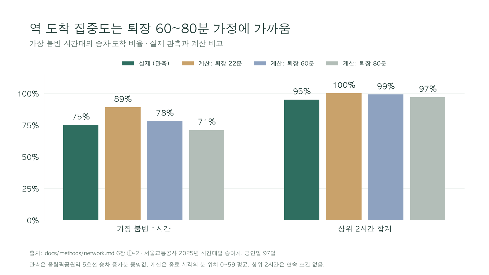
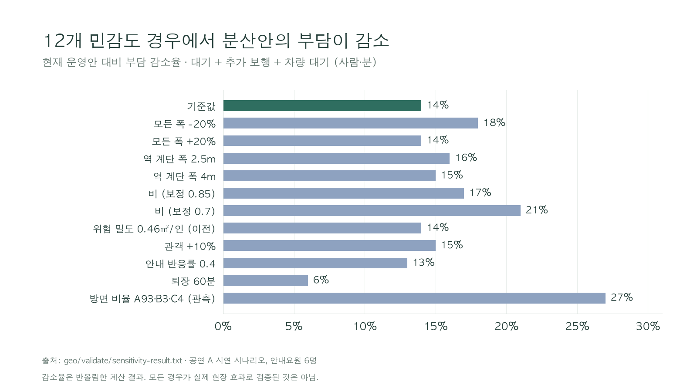

# OLPARK FLOW 데이터 활용과 검증 문안

팀원 B 담당 범위는 공연장 주변의 길·주차장 데이터, 계산 가정값, 관측 자료와의 비교다. 아래 요약과 상세 문안은 기획서에 옮겨 쓸 수 있다. 수치는 2026-11-22 저장소의 결과를 기준으로 하며, 인원 예측 모델의 학습 성능과 현장 운영 효과는 포함하지 않는다.

## 요약 문안

OLPARK FLOW는 공연 종료 후 관객이 지하철역과 주차장으로 이동할 때의 대기를 1분 단위로 계산하고, 안내 방향과 차량 출구 배정을 바꾼 운영안을 비교한다. 한국체육산업개발의 입출차 원본 2,411,225건과 연계 데이터 7,803건을 확보하고, 보행 경로·항공영상·지하철 승차 자료를 결합했다. 길 폭은 영상 판독에 따른 가정으로, 차량 출구 처리량은 관측 기반 값으로 구분했다.

지하철 승차 증가분을 분석한 공연 70건에서 올림픽공원역 방면 비율의 중앙값은 93%였다. 시연 시나리오의 기존 민감도 12개 경우에서는 분산안의 계산상 부담이 현재안보다 6~27% 감소했다. 이는 실제 현장 개선율을 뜻하지 않는다. 실제 종료 시각·게이트별 퇴장 인원·역 내부 처리 능력 자료를 추가 확보해 계산의 시간 기준과 병목 위치를 검증할 계획이다.

## 데이터 활용과 가공

### 공공데이터를 계산 입력과 검증 자료로 연결

| 데이터 | 확보 범위 | 활용 |
|---|---|---|
| 한국체육산업개발 입출차정보 API_CPM_008 | 원본 2,411,225건. 출차 시각은 2025-01-01~2026-02-17에 분포 | 차량 출구 처리량, 공연일 출차 시간 분포, 입차·출차 문 조합 검토 |
| 한국체육산업개발 연계 데이터 API_CPM_009 | 2025년 시간대별 7,803건 | 주차대수·방문객·기상·휴일을 팀원 A의 학습 보조 자료로 제공 |
| OpenStreetMap 보행로·지하철 출입구 | KSPO DOME에서 3개 역 지상 출입구까지 | 길 연결·좌표·길이·경유 경로 구성 |
| 브이월드·Esri 항공영상 | 공연장 주변 보행 경로 | 경로 확인과 길 폭 판독 |
| 서울시 지하철 역별 일별 승하차 | 2023~2025년, 3개 역 | 공연일 승차 증가분의 방면 비율 검증 |
| 서울교통공사 시간대별 승하차 | 2025년 올림픽공원역 5호선 | 공연일 저녁 승차 증가분의 시간대 집중도 비교 |

입출차정보는 입차 문·입차 시각·출차 문·출차 시각으로 정리했다. 분석마다 기간과 제외 기준을 기록해 원본 전체 건수와 실제 비교 표본을 구분했다. 예를 들어 문 조합 분석에서는 출차 연도가 2025년인 기록 중 입차가 출차보다 늦은 6,288건과 의미가 확인되지 않은 특수 차로 표기를 제외했다.

연계 데이터는 설명문에 묶인 주차대수·방문객·기온·풍향·강수량·습도·휴일을 열로 풀었다. 1년 8,760개 시간 중 957개 시간이 빠져 있고 강수량은 6,692건이 빈 값이어서, 이를 연속 시계열이나 무강수로 간주하지 않는다. 방문객을 공연 관객 수로 보거나 별도 공연 종료 시각이 있다고 가정하지 않는다. [데이터 열과 결측 기준](../../geo/data/README.md)

### 길과 차량 출구의 계산 입력 구성

보행 경로는 KSPO DOME의 남·동·서쪽 출구 후보에서 올림픽공원역 3번 출구, 한성백제역 2번 출구, 몽촌토성역 1번 출구까지 구성했다. 지도상 최단 거리만으로 숲속 샛길이나 주차장 통로를 선택하지 않도록 길 종류별 비용과 항공영상으로 확인한 경유점을 적용했다. 현재 연결은 점 20개와 길 토막 20개다.

길 폭은 항공영상의 포장 경계에서 장애물과 측방 여유를 뺀 유효 폭으로 정리했다. 역 계단처럼 지붕에 가려 확인하지 못한 곳은 가정으로 남겼다. 광장보다 횡단보도·숲 구간·역 출입구 계단이 좁아지는 지점을 병목 후보로 설정했으며, 현장 실측으로 확인한 병목이라는 의미는 아니다.

차량 출구는 공연일 16~24시 출차 기록의 10분 최대 평균을 출구별로 구하고, 일별 값의 상위 10%를 계산 입력에 반영했다. 북2문 10.0대/분, 동2문 9.8대/분, 남2문 11.9대/분이다. 이는 붐빈 날의 관측 기반 처리량이며 물리적 최대 용량을 인증한 값은 아니다. 주차장별 출구 연결과 차량당 2.4명, 교차점 보행 비율 0.6, 분기점당 안내요원 2명은 가정으로 구분한다. [방법과 근거 2~5장](../methods/network.md)

## 관측 자료와의 비교 결과

### 방면 비율과 역 도착 시간

공연일과 비공연일의 지하철 승차 차이를 이용해 귀가 수요의 방향을 비교했다. 평소 값은 날짜가 가까우면서 같은 요일 종류인 비공연일의 중앙값을 사용했다. 방면 비율 검증에서는 공연 신호가 약한 경우를 제외한 공연 70건을 분석했다. 올림픽공원역·한성백제역·몽촌토성역 방면 비율의 중앙값은 각각 93%·3%·4%였다. 이 값은 세 역의 승차 증가분 사이 비율이며 버스·도보·차량을 포함한 전체 관객의 교통수단 분담률은 아니다.

별도의 시간대 검증에서는 2025년 공연일 97일의 올림픽공원역 5호선 승차 증가분을 분석했다. 가장 붐빈 1시간의 비율은 중앙값 75%, 상위 2시간 합계는 95%였다. 상위 2시간은 반드시 연속된 시간이 아니다. 계산 결과를 동일하게 시 단위로 묶으면 퇴장 22분 가정은 89%·100%, 60분 가정은 78%·99%, 80분 가정은 71%·97%였다. 60~80분 가정이 관측된 집중도에 가깝지만, 공연장 퇴장 시간이 실제로 60~80분이라고 측정한 것은 아니다. 역 승차 전 대기·이동 등도 섞이므로 퇴장 시간의 확정값으로 쓰지 않는다. [방법 문서 6장 ① 및 ①-2](../methods/network.md)

### 차량 흐름의 검증 범위

입차가 출차보다 늦은 6,288건을 제외한 사후 점검에서도 출구 처리량 10.0·9.8·11.9대/분과 공연일 출차 증가량 중앙값 910대는 같았다. 다만 개별 날짜의 시간 분포는 달라져, 전체 제외율이 작다는 이유로 퇴장 시각에 영향이 없다고 판단할 수는 없다. [시각 역전 제외 전후 비교](../methods/vehicle-time-audit.md)

실제 공연 종료 시각이 없어 공연 종료 후 출차 완료 시간을 실측으로 검증할 수는 없었다. 대신 평소와 비교할 수 있는 공연일 28일의 16~24시 출차 증가분 분포를 구했다. 해당 분포에는 다른 시설 이용자와 비교일 차이가 섞이므로 그 시간 폭을 공연 관객의 퇴장 시간으로 해석하지 않는다.

입차·출차 문 조합은 별도로 분석했다. 공연일 16~24시에 출차하고 같은 날 입차한 표준 차로 기록은 349,334건·86일이었다. 북2문·동2문·남2문 사이 9개 조합이 모두 86일에 관측됐다. 입차 문과 출차 문이 다를 수 있음을 확인했지만 원본에 주차장 ID가 없어 주차장별 출구 연결은 검증하지 못했다. [문 조합 결과](../../geo/validate/parking-exit-result.json), [차량 시간 분포 결과](../../geo/validate/vehicle-check-result.json)

### 운영안 비교와 가정값 민감도

공연 A 시연 시나리오에서 폭·날씨·관객 수·안내 반응률·퇴장 시간·방면 비율을 바꾼 기존 12개 경우를 비교했다. 분산안의 계산상 부담 감소율은 6~27%였으며 기준값에서는 약 14%였다. 부담은 보행 대기·추가 보행·차량 대기를 사람·분으로 합산한 값이다. 특정 한 사람의 평균 시간이나 현장 혼잡 감소율과 같은 뜻으로 쓰지 않는다.

별도 검토에서는 보행 비율 0.4/0.6/0.8, 차량당 인원 2.0/2.4/3.0명, 분기점당 안내요원 1/2/3명의 27개 조합을 계산했다. 이 범위에서 부담 감소율은 7.57~26.34%였다. 이 범위는 검토용 가정이며 신뢰구간이 아니다. 탐색기에 현재안도 후보로 들어가므로 ‘현재안보다 나쁘지 않음’만으로 외부 검증이 되지는 않는다.

27개 조합에서 선택된 안내 분기점은 모두 1곳으로 인원 제약이 걸리지 않았다. 따라서 안내요원 수를 바꿔도 결과가 같다는 사실로 분기점당 적정 인원을 판단할 수 없다. 퇴장이 60분에 걸친 기존 시나리오에서는 모델상 보행 대기가 발생하지 않아, 역 내부 처리 능력을 추가 검토할 필요가 드러났다. 역 내부 병목의 위치나 크기를 실측한 결과는 아니다. [기존 12개 결과](../../geo/validate/sensitivity-result.txt), [별도 27개 결과](../../geo/validate/assumptions-sensitivity-result.json)

## 활용 범위와 후속 검증

현재 결과는 같은 입력에서 운영안을 비교하는 시연 계산과 관측 자료의 대조다. 현장 적용 전에는 공연장 출구별 실제 개방 여부·퇴장 비율, 길과 계단의 유효 폭, 교차점 통제 방식, 주차장별 출구 연결을 운영 자료로 확인해야 한다. 해외 사례의 동승 인원이나 안내요원 배치 비율은 국내 공연의 실측값으로 대체하지 않았다.

팀원 A에는 방면 비율과 시간대 집중도, 연계 데이터의 결측·방문객 항목 한계를 전달할 수 있다. 팀원 C와는 역 내부 계산 포함 여부, 주차 대수와 출구 연결의 필드별 출처 표시를 맞춰야 한다. 역 내부 자료 조사는 해당 범위를 계산에 포함하기로 결정한 뒤 진행한다.

## 추가 개방 요청 데이터 의견

공연별 실제 종료 시각과 출구별 퇴장 인원, 역 내부 통과량, 주차장별 출차 연결 자료를 우선 요청한다. 이 자료들은 현재의 가정을 관측값으로 바꾸고, 혼잡이 길·출구·역 내부 중 어디에서 생기는지 구분하는 데 필요하다.

| 우선순위 | 요청 자료와 집계 단위 | 활용 | 요청 대상 |
|---|---|---|---|
| 1 | 익명 공연 ID별 실제 종료 시각, 개방한 공연장 게이트, 게이트별 1분 퇴장 인원 | 퇴장 곡선·출구 비율 검증, 종료 후 시간 기준 정렬 | 한국체육산업개발·공연 운영 주체 |
| 1 | 역 출입구·계단 유효 폭, 개찰구 개방 수, 1~5분 통과량 | 지상 출입구와 역 내부 병목 구분 | 해당 역 운영기관 |
| 1 | 공연 시간대 열차 도착 간격, 이용 가능한 편성 수용량과 승차 여유의 집계 | 승강장·열차 수용 제약 검토 | 해당 노선 운영기관 |
| 2 | 주차장 ID별 입차·출차 문 조합과 5~10분 출차 대수 | 주차장별 출구 연결과 출차 곡선 검증 | 한국체육산업개발 |
| 2 | 실제 교차점의 보행·차량 통제 주기, 허용 시간, 전환 손실 시간 | 보행 비율 0.6 가정 교체 | 시설·교통 운영 담당 |
| 2 | 공연별 운전자 포함 차량 평균 탑승 인원, 주차장까지 이동 시간 분포, 분기점 역할별 배치 인원 | 차량 대수·도보 지연·안내 자원 가정 보정 | 공연·주차·현장 운영 담당 |

요청 단위는 개인 식별 정보와 차량번호 없이 활용할 수 있는 시설·시간 구간별 집계다. 공연명은 익명 공연 ID로 연결할 수 있다. 실제 종료 시각과 집계 자료의 시간 기준이 같아야 공연별 검증이 가능하다.

## 그림 배치와 캡션

### 그림 1 방면 비율

**캡션:** 2023~2025년 공연 70건의 지하철 승차 증가분을 비교한 방면 비율 중앙값. 올림픽공원역 93%, 한성백제역 3%, 몽촌토성역 4%다. 목업 72%·19%·9%와 구분하며 전체 교통수단 분담률로 해석하지 않는다.

### 그림 2 역 도착 집중도

**캡션:** 2025년 공연일 97일의 올림픽공원역 5호선 승차 증가분에서 가장 붐빈 1시간과 상위 2시간의 비율 중앙값은 각각 75%·95%였다. 계산은 종료 시각의 분 위치를 평균해 시 단위로 비교했다. 퇴장 60~80분 가정은 관측 집중도에 가까운 비교 시나리오다.

### 그림 3 기존 민감도 12개 경우

**캡션:** 공연 A 시연 입력과 안내요원 6명 조건에서 기존 민감도 12개 경우의 계산상 부담 감소율은 6~27%다. 현장 개선율을 실측한 결과가 아니다. 별도 27개 조합 검토와 표본 수·범위를 구분한다.

## 수치와 근거 확인표

| 기획서에 쓸 수치 | 분모와 의미 | 근거 |
|---|---|---|
| 2,411,225건 | API_CPM_008 원본 전체. 모두 2025년 출차는 아님 | [원본 설명](../../geo/data/README.md) |
| 7,803건 | API_CPM_009 시간대별 자료. 누락 시간·항목 결측 존재 | [연계 데이터 설명](../../geo/data/README.md) |
| 93%·3%·4% | 공연 70건의 3개 역 승차 증가분 방면 비율 중앙값 | [방법 문서 6장](../methods/network.md) |
| 75%·95% | 공연일 97일, 올림픽공원역 5호선 시간대 집중도 중앙값 | [방법 문서 6장](../methods/network.md) |
| 10.0·9.8·11.9대/분 | 북2문·동2문·남2문의 붐빈 날 관측 기반 처리량 | [현재 차량 입력](../../src/data/parking.json), [방법 문서 4장](../methods/network.md) |
| 28일 | 평소 비교일이 충분한 차량 시간 분포 분석 | [집계 결과](../../geo/validate/vehicle-check-result.json) |
| 349,334건·86일 | 공연일 저녁 출차·같은 날 입차·표준 차로 조건 | [문 조합 결과](../../geo/validate/parking-exit-result.json) |
| 6~27% | 기존 12개 민감도 경우의 계산상 부담 감소율 | [결과 원본](../../geo/validate/sensitivity-result.txt) |
| 7.57~26.34% | 별도 27개 가정 조합의 계산상 부담 감소율 | [결과 JSON](../../geo/validate/assumptions-sensitivity-result.json) |

일별 승차 자료와 시간대별 승차 자료는 서로 다른 표본이다. 차량 시간 분포 28일과 문 조합 86일도 분석 조건이 다르다. 지하철 원본 CSV는 저장소에 포함되지 않아 기존 결과를 재현하려면 별도 원본이 필요하다. 원본 입력 경로와 실행 방법은 [검증 스크립트](../../geo/validate/subway_check.py)에 있다.
